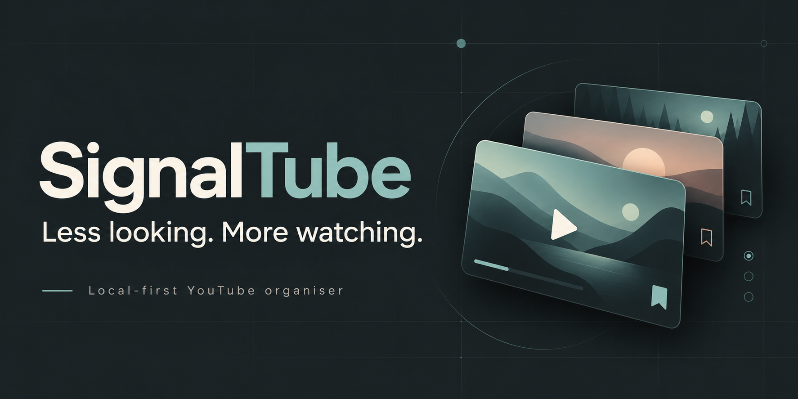

# SignalTube



**Public beta · Linux / Omarchy · MIT licence · Bring your own Google API key**

YouTube’s notification bell tells you something arrived. It does not make it easy to catch up once you fall behind. SignalTube gives those uploads a calmer place to wait: an explainable next-watch list, a catch-up queue and a separate place for things you deliberately save.

A calmer, local-first YouTube organiser for Linux, with Omarchy theme support.

**Watch next** keeps a manually built, explainable shortlist. **Catch up** shows cached uploads you have not reviewed in SignalTube. **Saved** is your deliberate queue. Save, Watched, Dismiss and one-step Undo are local choices, not changes to your YouTube account.

No cloud AI, embedded player, remote thumbnails, analytics, automatic watch tracking or background YouTube polling. Video links open YouTube in your browser. Category illustrations are local artwork, not video thumbnails. Local-model integration is deferred.

## Choose your setup

| Option | Google key? | What you get |
|---|---|---|
| Try the design and fictional demo | No | Interactive `/preview` and the original synthetic import dashboard at `/` |
| Use public channel uploads | Your own key | Manual collection, Watch next, Catch up, Saved and creator organisation |
| Add your Takeout history | Optional for import; needed for live uploads | Local history counts for ranking and an imported subscription list to choose from |

See [the small-group tester guide](TESTING.md) for the short installation and feedback checklist. **No app-menu icon is installed in this candidate**; launch is currently via the folder’s `run.sh` command.

## Install locally

Supported target: Linux (tested on Omarchy), Python 3.12 or newer. The launcher and file locks use Unix facilities; Windows is not currently supported. Omarchy is optional: another Linux desktop gets a readable fallback palette. You need `uv` installed through its official instructions at https://docs.astral.sh/uv/getting-started/installation/ or your distribution. Installing Python dependencies requires an Internet connection; using already-cached data does not.

Download the [latest public beta](https://github.com/shaggyrs6-netizen/signaltube/releases), or clone this repository:

```bash
git clone https://github.com/shaggyrs6-netizen/signaltube.git
cd signaltube
```

Then install the locked dependencies and launch:

```bash
uv sync --frozen
./run.sh
```

If the executable bit was lost during extraction, use `bash run.sh` or `chmod +x run.sh`.

The launcher starts or reuses a server on **127.0.0.1:8765**, opens a private login link in your default browser, and prints that link for use in another browser. The launch link lands on Watch next. Keep it private. The server keeps running when you close the terminal; it does not start at login.

```bash
./run.sh status
./run.sh stop
./run.sh launch --no-open  # print the private link instead of opening a browser
```

If locked, run `./run.sh` again and open its link. A normal direct URL is not an unlock link. `./run.sh serve` runs in the foreground instead (Ctrl+C stops it). For a busy port, use `./run.sh launch --port 8766` and the same port for status/stop. Never kill an unknown process to reclaim a port. Keep one production copy so the local quota ledger is not split across checkouts.

## Option A: no-key demo

```bash
./run.sh demo
./run.sh
```

Visit `/preview` for the fictional visual demo, or `/` for the imported synthetic records. Demo actions do not edit your real choices. The real `/watch` page will have no uploads until you explicitly refresh with your own key. There is no paid account requirement for the demo.

## Option B: public uploads

Follow [Google API setup and quota](API-SETUP.md). Every user supplies their own key and Google project; no shared developer key is bundled.

```bash
./run.sh key-add
```

Paste the key into the hidden local terminal prompt. Never put it in a command argument, screenshot, issue or Git commit. Then open `/watch` and explicitly choose **Refresh from YouTube**. Saving the key or starting the app does not refresh.

A fresh installation starts with three public example channels: Mentour Pilot, Learn Linux TV and Two Minute Papers. You can manage selected imported channels in `/subscriptions`. Tracking changes have a quota preview and explicit Apply; they never automatically track an entire Takeout export.

Build Watch next using **Build my five**. Its selected references survive navigation/restart. Opening it does not build a replacement list. Save options only remembers profile, category and history options without building. Dismissed/watched/untracked/expired references are omitted; use Build again to choose new ones. Order stays fixed until that action; displayed reasons reflect current preferences and cache.

Catch up means **unreviewed in SignalTube**, not necessarily unseen on YouTube. A saved video can remain unreviewed; Watched/Dismiss clears it from Catch up. Saved status is independent, so a watched saved video may stay in Saved until unsaved. Undo restores the immediately previous dashboard choice, even after restart. A newer dashboard action replaces the one-step Undo; editing the same video elsewhere invalidates it rather than overwriting a later change.

## Option C: import your history

Request a Google Takeout YouTube export with subscriptions and history in CSV/JSON. Extract only the files you choose locally. ZIP and HTML input are not accepted by this importer.

```bash
./run.sh takeout-preview --profile local \
  --subscriptions '/absolute/path/subscriptions.csv' \
  --history '/absolute/path/watch-history.json'
```

Review the counts/errors and copy the reported `preview_id`. Then rerun with the same paths and profile:

```bash
./run.sh takeout-import --profile local \
  --subscriptions '/absolute/path/subscriptions.csv' \
  --history '/absolute/path/watch-history.json' \
  --confirm 'PASTE_THE_PREVIEW_ID_HERE'
```

Imports are additive and duplicate-safe. The original files are unchanged. Preview/Import use no YouTube quota and never enable tracking automatically. Choose the same profile (`local` in this example) in Watch next, `/takeout` and `/subscriptions`; a missing profile is shown explicitly. The importer currently recognises English `Watched` activity records; other languages/export variants need validation. Event counts are not completion or watch duration.

## Limits and privacy

- Hard **100-unit daily local cap**, even if Google gives the project a larger allowance. Reserve the whole batch before requests; failures retain their reservations. A 15-minute cooldown applies. No automatic retries or schedules.
- Up to 50 recent uploads per tracked creator per refresh. This is not a full notification archive. API metadata expires after 30 days and is purged when the app runs; personal choices remain, but expired details cannot be displayed until legitimately fetched again.
- Omarchy colours follow the active palette through a local stylesheet check. SignalTube never edits desktop theme files. No shell plugin is required.
- Private runtime files live under `var/`, including Takeout data, API key and local session credential. Do not share that folder, launch URLs, logs or database files. Owner-only permissions are not encryption or isolation from other processes under your account.
- See the in-app `/privacy` page and [recovery guidance](RECOVERY.md).

## Development

```bash
uv sync --frozen
uv run --frozen pytest -q
```

Tests use synthetic fixtures and fake API transports, not a real Google key. No automatic live-API test runs. Contributions and bug reports are welcome: see [CONTRIBUTING.md](CONTRIBUTING.md). Security issues belong in [private vulnerability reports](SECURITY.md).


## Status and limitations

This is an early public beta for a small group of testers, not a finished desktop package. There is no app-menu entry, desktop installer or automatic updater. Start with the demo if you want to try the layout before setting up an API key.

The current synthetic suite has **72 passing tests**, including actual server stop/restart checks for Save, Watched, Dismiss and Undo. Live collection and duplicate checks have passed in development; observing a genuinely new upload after a baseline remains a pending field check. This is not a Google compliance certification or a complete accessibility audit. Please report what happens on your own setup.

## Licence and credits

Released under the [MIT licence](LICENSE). SignalTube is independent and is not affiliated with or endorsed by YouTube, Google or Omarchy. YouTube playback and data access remain subject to their respective terms. The cover graphic was generated for this project; category illustrations are local SVG artwork. No external fonts, thumbnails or analytics are loaded by the app.
